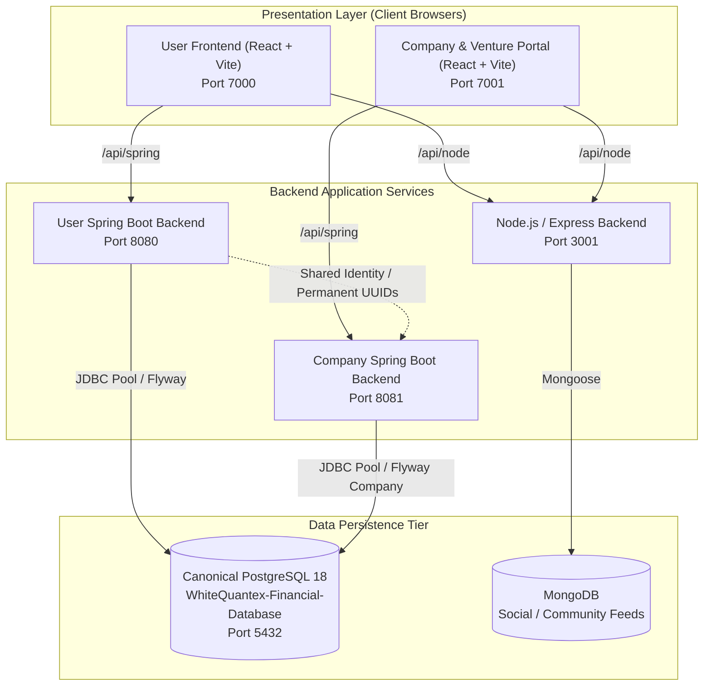

# White Quantex 2.0 — Comprehensive Architecture & System Documentation

```
========================================================================================
Platform:      White Quantex (Version 2.0)
Architecture:  Dual Spring Boot Backends + Node.js Community Backend + Dual React SPAs
Database:      Shared Canonical PostgreSQL (37+ Tables) + MongoDB (Social Feeds)
Date:          November 19, 2026
========================================================================================
```

---

## 1. System Overview & Platform Vision

**White Quantex 2.0** is an institutional-grade, full-stack financial technology ecosystem providing dual-sided capital markets infrastructure:
1. **The Investor & Retail Ecosystem (User Module)**: Secondary market order execution, real-time valuation charting, portfolio holdings management, live quotes, SEC CIK verification, and social investor communities.
2. **The Corporate & Venture Capital Portal (Company Module)**: Regulated corporate issuer onboarding, venture launchpads, SEC Rule 506(c) verification workflows, team cap-table permissions, and atomic graduation pipelines.

### High-Level Topology



---

## 2. Shared Database Architecture & Ownership Model

Both backend engines connect concurrently to the same PostgreSQL database (`WhiteQuantex-Financial-Database`) without schema collisions or cross-service write races.

```
                  WHITE QUANTEX FRONTEND LAYER
                                |
               -----------------------------------
               |                                 |
         USER BACKEND                     COMPANY BACKEND
      (Spring Boot :8080)               (Spring Boot :8081)
               |                                 |
               -----------------------------------
                                |
                   PostgreSQL (Port 5432)
                Shared Canonical Database
```

### Strict Table Ownership Boundaries

| Module | Data Domain | Owned Tables (Full CRUD) | Access Rules |
|---|---|---|---|
| **User Module** (`:8080`) | Identity, Security, Holdings, Trades | `users`, `roles`, `user_roles`, `user_sessions`, `user_session_activities`, `user_portfolios`, `investments`, `corporate_orders`, `corporate_positions`, `venture_orders`, `venture_positions`, `company_price_current`, `company_price_history`, `company_price_candles`, `kyc_applications` | Holds exclusive write authority over identity, credential hashes, and trading portfolios. |
| **Company Module** (`:8081`) | Issuer Profiles, Memberships, Verifications, Life-Cycle | `companies`, `ventures`, `company_memberships`, `company_verifications`, `company_documents`, `graduation_applications`, `business_lifecycle_history`, `company_audit_logs`, `company_idempotency_keys`, `company_quarterly_financials` | Holds exclusive write authority over corporate rosters, filings, legal tiers, and lifecycle graduation. |
| **Cross-Module** | Identity Federation | Read-only access to `users` via `@Immutable` entity `UserEntity.java` | Company Module never modifies passwords, user emails, or generates synthetic user IDs. |

### Flyway History Isolation
To prevent Flyway schema checksum locks between independent services:
- **User Module Flyway Table**: `flyway_schema_history`
- **Company Module Flyway Table**: `flyway_company_history` (`spring.flyway.table: flyway_company_history`)

---

## 3. Seven Concurrency Scenarios & Engineering Protections

The Company Module enforces production-tested safeguards across 7 concurrent financial workflows:

### Scenario 1: Duplicate Registration Prevention
- **Risk**: Concurrent POST requests registering the same corporate ticker, SEC CIK, or legal name.
- **Protection**: 
  - Database-level unique constraints (`companies_ticker_key`, `companies_cik_key`, `ventures_ticker_key`, `ventures_cik_key`).
  - Pre-insert existence checks via Spring Data JPA.
  - Returns `409 Conflict` with human-readable error messaging.

### Scenario 2: Concurrent Membership Creation
- **Risk**: Two company admins simultaneously inviting or adding the same user, causing duplicate team permissions.
- **Protection**:
  - Unique compound database constraint: `CONSTRAINT uq_company_membership UNIQUE (company_id, user_id)`.
  - Transactional existence validation in `CompanyMembershipService.java`.

### Scenario 3: Stale Profile Overwrites (Optimistic Locking)
- **Risk**: Two company officers editing corporate headquarters or CEO details concurrently, resulting in lost updates.
- **Protection**:
  - JPA `@Version private Long version;` on `CompanyEntity` and `VentureEntity`.
  - Stale requests submitting a previous version trigger `OptimisticLockingFailureException`, translated to HTTP `409 Conflict`.

### Scenario 4: Concurrent Ownership Transfer (Pessimistic Locking)
- **Risk**: Simultaneous ownership transfers or hostile race conditions resulting in multiple owners or inconsistent states.
- **Protection**:
  - Database-level pessimistic write lock:
    ```java
    @Lock(LockModeType.PESSIMISTIC_WRITE)
    @Query("SELECT c FROM CompanyEntity c WHERE c.id = :id")
    Optional<CompanyEntity> findByIdWithPessimisticLock(@Param("id") UUID id);
    ```
  - Caller must match the existing `owner_user_id`. Demotes previous owner to `ADMIN` and elevates new user to `OWNER` in one atomic transaction.

### Scenario 5: Verification Race Conditions
- **Risk**: Submitting multiple concurrent verification filings while one is active, or two compliance officers reviewing the same case.
- **Protection**:
  - Queries active status (`PENDING`, `UNDER_REVIEW`). If an active application exists, re-submissions are rejected with HTTP 409.
  - Review actions lock the verification record with `PESSIMISTIC_WRITE` and prevent state transition mutation once `APPROVED` or `REJECTED`.

### Scenario 6: Startup Graduation with UUID Preservation
- **Risk**: A startup graduating to established company status could create a disjoint entity ID, corrupting secondary market position history.
- **Protection**:
  - Pessimistic lock on the `ventures` record.
  - Atomically creates the `companies` profile **preserving the exact original UUID** (`company.setId(venture.getId())`).
  - Inserts transition record into `business_lifecycle_history` and flags `is_graduated = true` atomically.

### Scenario 7: Network Retries & Idempotency
- **Risk**: Network timeouts causing client retries that trigger duplicate mutations.
- **Protection**:
  - `X-Idempotency-Key` request header intercepted by `IdempotencyService`.
  - Keys stored in `company_idempotency_keys` with serialized response payload. Replays the exact HTTP status and response without re-executing business logic.

---

## 4. Security, Authentication & Role Isolation

### Dual-Token & Identity Flow
- **HMAC-SHA256 Token Validation**: Shared secret key (`${app.jwt.secret}`) allows the Company Module to validate JWTs issued by the User Module's authentication service.
- **Role Verification**:
  - **User Portal (Port 7000)**: Serves `INVESTOR`, `RETAIL`, and general market participants.
  - **Company Portal (Port 7001)**: Strictly restricted to corporate roles (`CORPORATE`, `FOUNDER`, `COMPANY`, `VENTURE`, `ADMIN`).
- **Portal-Wide Access Guard**:
  - Unauthenticated visitors on Port 7001 are redirected to `/login`.
  - Retail/individual accounts without company credentials encounter a dedicated Access Barrier with a 1-click return link to Port 7000.
  - Whitelisted demo account: `demo@whitequantex.com` (password: `demo123`) has elevated permissions (`FOUNDER`, `ADMIN`, `COMPANY_FUNDRAISING`).

---

## 5. Service Port Matrix & Running Processes

| Service | Directory | Tech Stack | Port | Health Check / Entrypoint |
|---|---|---|---|---|
| **User Frontend** | `User Module/frontend` | React Router 7, Vite, TailwindCSS | `7000` | [http://localhost:7000](http://localhost:7000) |
| **Company Frontend** | `Company Module/frontend` | React Router 7, Vite, TailwindCSS | `7001` | [http://localhost:7001](http://localhost:7001) |
| **User Backend** | `User Module/backend-spring` | Spring Boot 3.4, Java 21, Spring Security | `8080` | [http://localhost:8080/actuator/health](http://localhost:8080/actuator/health) |
| **Company Backend** | `Company Module/backend-spring` | Spring Boot 3.4, Java 21, JPA | `8081` | [http://localhost:8081/actuator/health](http://localhost:8081/actuator/health) |
| **Social / Chat** | `User Module/backend` | Node.js, Express, MongoDB, Socket.io | `3001` | [http://localhost:3001/health](http://localhost:3001/health) |
| **Database** | PostgreSQL 18 Service | PostgreSQL | `5432` | `WhiteQuantex-Financial-Database` |

---

## 6. REST API Reference (Company Module - Port 8081)

All endpoints documented under interactive Swagger UI at **[http://localhost:8081/swagger-ui.html](http://localhost:8081/swagger-ui.html)**.

### Entity Registration & Lookup
- `POST /api/companies`: Register an established corporate issuer. Returns permanent Company UUID.
- `POST /api/companies/ventures`: Register a venture startup. Returns permanent Venture UUID.
- `GET /api/companies/{id}`: Retrieve company or venture details by UUID.
- `GET /api/companies/ticker/{ticker}`: Retrieve entity details by stock symbol.
- `GET /api/companies/check-ticker/{ticker}`: Check symbol availability.
- `GET /api/companies/my-companies`: List entities owned by the authenticated caller.
- `PUT /api/companies/{id}`: Update allowlisted company details (optimistic lock protected).

### Team & Cap-Table Management
- `GET /api/companies/{id}/members`: List active team members and roles.
- `POST /api/companies/{id}/members`: Add new team member (checks uniqueness).
- `PUT /api/companies/{id}/members/{memberId}`: Update member role (`ADMIN`, `MEMBER`, `OFFICER`).
- `DELETE /api/companies/{id}/members/{memberId}`: Remove team member.
- `POST /api/companies/{id}/members/transfer-ownership`: Transfer corporate ownership under pessimistic lock.

### Verification & Compliance Workflows
- `POST /api/companies/{id}/verification`: Submit entity for SEC 506(c) verification.
- `GET /api/companies/{id}/verification`: List verification application history.
- `PUT /api/companies/{id}/verification/{verificationId}/review`: Admin review & adjudication (`APPROVED` / `REJECTED`).

### Startup Lifecycle & Graduation
- `POST /api/companies/{id}/lifecycle/graduate`: Venture applies for public listing graduation.
- `POST /api/companies/{id}/lifecycle/graduation/{applicationId}/approve`: Admin graduation approval (atomic transition with UUID preservation).
- `GET /api/companies/{id}/lifecycle/history`: Full audit trail of lifecycle classification changes.

---

## 7. Operational Runbook & Development Guide

### Starting the Platform

1. **Database Service**:
   Ensure PostgreSQL is running locally on port `5432`.
   ```powershell
   $env:PGPASSWORD="8426"; psql -U postgres -h localhost -d WhiteQuantex-Financial-Database -c "SELECT 1;"
   ```

2. **Start User Backend (Port 8080)**:
   ```powershell
   cd "User Module/backend-spring"
   .\mvnw.cmd spring-boot:run
   ```

3. **Start Company Backend (Port 8081)**:
   ```powershell
   cd "Company Module/backend-spring"
   .\mvnw.cmd spring-boot:run
   ```

4. **Start User Frontend (Port 7000)**:
   ```powershell
   cd "User Module/frontend"
   npm run dev
   ```

5. **Start Company Frontend (Port 7001)**:
   ```powershell
   cd "Company Module/frontend"
   npm run dev
   ```

### Running Test Suites
- **Company Module Concurrency Tests**:
  ```powershell
  cd "Company Module/backend-spring"
  .\mvnw.cmd test
  ```
- **User Module Regression Tests**:
  ```powershell
  cd "User Module/backend-spring"
  .\mvnw.cmd test
  ```
- **Frontend Production Builds**:
  ```powershell
  cd "Company Module/frontend"; npm run build
  cd "User Module/frontend"; npm run build
  ```
