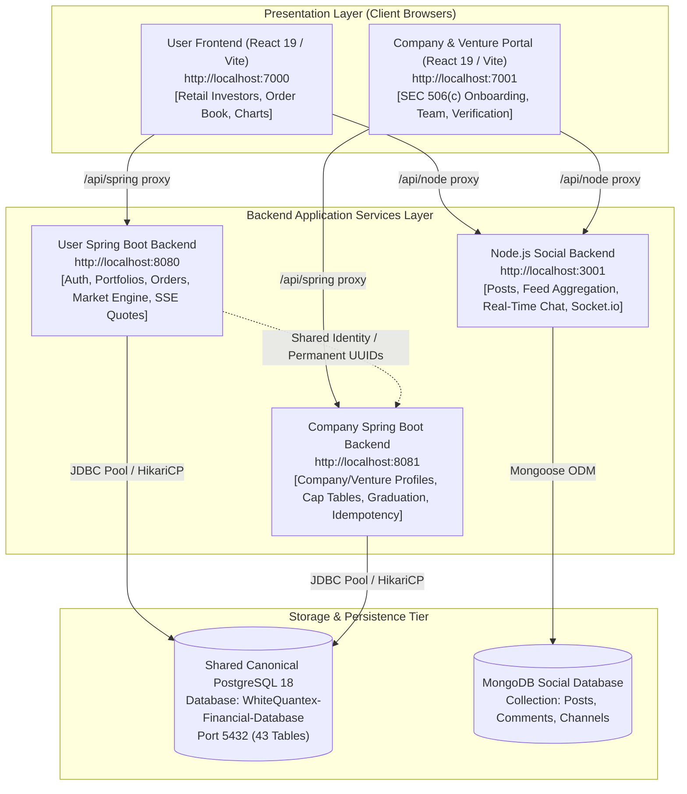

# White Quantex 2.0 — Complete Technical & Reverse-Engineering Specification

```
========================================================================================================
Platform:             White Quantex (Version 2.0)
Architecture:         Dual Spring Boot Micro-Services + Node.js/Socket.io Social Backend + Dual React SPAs
Databases:            PostgreSQL 18 (Canonical Truth Engine, 43 Tables) + MongoDB (Social Feeds)
Target Audience:      Full-Stack Engineers, Financial Architects, Security Auditors, and Reverse Engineers
Document Version:     2.0.0-PROD
Last Updated:         November 19, 2026
========================================================================================================
```

---

## 1. High-Level Architecture & Process Topology

White Quantex is composed of 5 distinct runtime nodes running across designated ports with strict responsibilities:



### Process Matrix

| Service | Directory | Tech Stack | Port | PID / Entrypoint |
|---|---|---|---|---|
| **User Frontend** | `User Module/frontend` | React Router 7, Vite, TailwindCSS, Lucide, Recharts | `7000` | `npm run dev` |
| **Company Frontend** | `Company Module/frontend` | React Router 7, Vite, TailwindCSS, Zustand | `7001` | `npm run dev` |
| **User Backend** | `User Module/backend-spring` | Spring Boot 3.4.0, Java 21, Spring Security, Flyway | `8080` | `com.whitequantex.WhiteQuantexApplication` |
| **Company Backend** | `Company Module/backend-spring` | Spring Boot 3.4.0, Java 21, Spring Data JPA, Flyway | `8081` | `com.whitequantex.company.CompanyBackendApplication` |
| **Social / Community** | `User Module/backend-node` | Node.js (ESM), Express, MongoDB, Socket.io | `3001` | `server.mjs` |
| **Primary Database** | PostgreSQL 18 Server | Relational Engine, ACID Transactions | `5432` | `WhiteQuantex-Financial-Database` |

---

## 2. Complete Database Schema & Reverse-Engineering Dictionary

The canonical PostgreSQL database (`WhiteQuantex-Financial-Database`) contains 43 tables structured across 6 core functional domains:

### 2.1 Identity, Authentication & Permissions Domain (Owned by User Backend `:8080`)
1. **`users`**: Master table for all human actors.
   - `id (UUID PRIMARY KEY)`: Permanent UUID assigned at creation. Reused across the entire platform.
   - `email (VARCHAR(255) UNIQUE)`: Login identifier.
   - `password_hash (VARCHAR(255))`: BCrypt password hash.
   - `first_name`, `last_name`, `username`, `display_name`: Identity profile.
   - `primary_role (VARCHAR(255))`: Default role (`INVESTOR`, `FOUNDER`, `CORPORATE`, `ADMIN`).
   - `account_type (VARCHAR(255))`: `individual`, `institutional`, or `corporate`.
   - `verification_level (VARCHAR(255))`: `NONE`, `BRONZE`, `SILVER`, `GOLD`, `PLATINUM`.
   - `kyc_status (VARCHAR(255))`: `NONE`, `SUBMITTED`, `VERIFIED`, `REJECTED`.
   - `trust_score (INT)`: Algorithmic credibility index (0–100).
   - `two_factor_enabled (BOOLEAN)`, `is_active (BOOLEAN)`.
2. **`roles`**: Authority definitions (`1: INVESTOR`, `2: FOUNDER`, `3: COMPANY_FUNDRAISING`, `4: CORPORATE_INVESTOR`, `5: ADMIN`).
3. **`user_roles`**: Many-to-many bridge `(user_id, role_id)`.
4. **`user_sessions`**: Active session tracker (`id`, `user_id`, `token_hash`, `expires_at`, `ip_address`, `user_agent`).
5. **`user_session_activities`**: Security event logs (`LOGIN_SUCCESS`, `PASSWORD_RESET`, `TOKEN_REFRESH`).
6. **`kyc_applications`**: Identity verification submissions (`id`, `user_id`, `document_type`, `document_url`, `status`).

### 2.2 Corporate & Venture Issuer Domain (Owned by Company Backend `:8081`)
7. **`companies`**: Established institutional corporate issuers.
   - `id (UUID PRIMARY KEY)`: Permanent business UUID.
   - `ticker (VARCHAR(20) UNIQUE)`: Symbol (e.g. `ZEPR`, `VOCL`, `TFLOW`).
   - `name (VARCHAR(255))`, `short_name (VARCHAR(100))`.
   - `legal_entity (VARCHAR(150))`: Legal corporate type (e.g. `Delaware C-Corp`).
   - `cik (VARCHAR(50) UNIQUE)`: SEC Central Index Key (`CIK-0002100099`).
   - `sector`, `sub_industry`, `headquarters`, `region`, `founded_year`, `ceo`, `employees`.
   - `valuation_num (NUMERIC(18,2))`, `annual_revenue_num (NUMERIC(18,2))`.
   - `quarterly_revenue (NUMERIC(18,2))`, `quarterly_profit (NUMERIC(18,2))`.
   - `last_financial_update (TIMESTAMPTZ)`.
   - `verification_level (VARCHAR(50))`, `trust_score (INT)`.
   - `exchange_tier`: `Tier-1 Institutional`, `Tier-2 Growth`.
   - `lifecycle_classification`: `ESTABLISHED_COMPANY`.
   - `lifecycle_status`: `ACTIVE`, `SUSPENDED`.
   - `owner_user_id (UUID REFERENCES users(id))`: Primary corporate administrator.
   - `version (BIGINT NOT NULL DEFAULT 0)`: **JPA `@Version` optimistic locking column**.
8. **`ventures`**: Early-stage venture startups.
   - `id (UUID PRIMARY KEY)`: Permanent startup UUID.
   - `ticker (VARCHAR(20) UNIQUE)`, `cik (VARCHAR(50) UNIQUE)`.
   - `round_type (VARCHAR(50))` (`Seed`, `Series A`, `Series B`).
   - `target_raise_num (NUMERIC(18,2))`, `raised_amount_num (NUMERIC(18,2))`.
   - `min_investment_num (NUMERIC(18,2))` (typically `$25,000.00`).
   - `security_type`: `Series A Preferred Stock`, `SAFE Note`.
   - `lifecycle_classification`: `STARTUP`.
   - `graduation_eligible (BOOLEAN)`, `is_graduated (BOOLEAN)`.
   - `owner_user_id (UUID REFERENCES users(id))`.
   - `version (BIGINT NOT NULL DEFAULT 0)`: **Optimistic locking column**.
9. **`company_memberships`**: Team rosters and administrative privileges.
   - `id (UUID PRIMARY KEY)`.
   - `company_id (UUID NOT NULL)`.
   - `user_id (UUID NOT NULL REFERENCES users(id))`.
   - `role (VARCHAR(32))` (`OWNER`, `ADMIN`, `MEMBER`, `OFFICER`).
   - `CONSTRAINT uq_company_membership UNIQUE (company_id, user_id)`.
10. **`company_verifications`**: SEC 506(c) verification workflow.
    - `id`, `company_id`, `status` (`PENDING`, `UNDER_REVIEW`, `APPROVED`, `REJECTED`).
    - `business_registration_number`, `tax_id`, `incorporation_jurisdiction`.
    - `submitted_by (UUID REFERENCES users(id))`, `reviewer_user_id (UUID REFERENCES users(id))`.
    - `version (BIGINT)`: Optimistic locking version.
11. **`company_documents`**: SEC filings, financial disclosures, and bylaws.
12. **`graduation_applications`**: Venture-to-Company transition filings.
    - `id`, `business_id`, `ticker`, `application_status` (`SUBMITTED`, `APPROVED`, `REJECTED`).
    - `revenue_run_rate`, `customer_count`, `decision_reason`.
13. **`business_lifecycle_history`**: Immutable lifecycle transition records.
    - `id`, `business_id`, `previous_classification`, `new_classification`, `performed_by`, `effective_at`.
14. **`company_audit_logs`**: Tamper-evident corporate change ledger.
    - `id`, `company_id`, `actor_user_id`, `action`, `previous_state`, `new_state`, `created_at`.
15. **`company_idempotency_keys`**: Idempotent network retry cache.
    - `key (VARCHAR(128) PRIMARY KEY)`, `user_id`, `endpoint`, `response_status`, `response_body`.
16. **`company_quarterly_financials`**: 3-Month quarterly filings.
    - `id`, `company_id`, `ticker`, `quarter`, `fiscal_year`, `quarter_number`, `revenue`, `profit`, `expenses`, `growth_rate`, `profit_margin`.

### 2.3 Secondary Markets & Algorithmic Pricing Domain (Owned by User Backend `:8080`)
17. **`company_price_current`**: Live price snapshot (`symbol`, `latest_price`, `price_change`, `percent_change`, `volume_24h`, `price_timestamp`).
18. **`company_price_history`**: High-resolution historical pricing ticks (`id`, `symbol`, `price`, `volume`, `price_timestamp`).
19. **`company_price_candles`**: Aggregated OHLCV candle records (`1m`, `5m`, `1h`, `1d`).
20. **`market_instruments`**: Exchange listing directory (`symbol`, `asset_type`, `is_tradable`, `lot_size`).
21. **`market_data_ingestion_log`**: Feed telemetry records.
22. **`corporate_orders` & `venture_orders`**: Executed and open buy/sell orders.
23. **`corporate_positions` & `venture_positions`**: Investor balance sheet holdings.

---

## 3. Core Business Logic & Mathematical Formulas

### 3.1 Base Share Price Calculation (`MarketPriceService.java`)
When a company or venture is registered, its initial share price is derived from its valuation:
$$\text{Share Price} = \max\left(10.00, \min\left(1500.00, \frac{\text{ValuationNum}}{2,500,000.00}\right)\right)$$

### 3.2 Dynamic Trading Price Surge Formula
When an investor purchases shares of a company, the demand-driven price impact is computed instantaneously:
$$\text{Impact \%} = \min\left(12.00, \max\left(0.75, \frac{\text{Shares}}{500} \times 0.45 + \frac{\text{AmountInvested}}{50,000} \times 0.65\right)\right)$$
$$\text{New Price} = \text{Old Price} \times \left(1 + \frac{\text{Impact \%}}{100}\right)$$

### 3.3 Dynamic Market Cap Surge
$$\text{New Valuation} = \text{Old Valuation} \times \left(1 + \frac{\text{Impact \%} \times 0.85}{100}\right)$$

### 3.4 Quarterly Financial Calibration Formula
Every three months, corporate entities report `Revenue` and `Profit`. The platform recalibrates market valuation and stock price:
$$\text{Annualized Revenue} = \text{Quarter Revenue} \times 4$$
$$\text{Profit Margin} = \frac{\text{Quarter Profit}}{\text{Quarter Revenue}}$$
$$\text{Calibrated Valuation} = (\text{Annualized Revenue} \times 4.2) + (\text{Quarter Profit} \times 4 \times 10.0)$$
$$\text{Price Adjustment Factor} = \min\left(1.35, \max\left(0.70, \frac{\text{Calibrated Valuation}}{\text{Current Valuation}}\right)\right)$$
$$\text{New Stock Price} = \text{Current Stock Price} \times \text{Price Adjustment Factor}$$

---

## 4. Concurrency & Integrity Mechanics (The 7 Pillars)

| Scenario | Risk Vector | Mitigation Implementation |
|---|---|---|
| **1. Duplicate Entity Registration** | Simultaneous attempts to claim ticker/CIK/name | DB Unique Constraints + existence check in `CompanyService.java` -> HTTP 409 Conflict. |
| **2. Concurrent Team Invitations** | Concurrent requests adding the same user to a team | Compound constraint `UNIQUE (company_id, user_id)` on `company_memberships`. |
| **3. Concurrent Profile Updates** | Stale overwrites losing corporate metadata | JPA `@Version` column triggers `ObjectOptimisticLockingFailureException` -> HTTP 409. |
| **4. Concurrent Ownership Transfer** | Race condition transferring corporate control | `@Lock(LockModeType.PESSIMISTIC_WRITE)` on company/venture record. Prevents concurrent transfer and executes atomic demotion/promotion. |
| **5. Verification Review Collisions** | Simultaneous duplicate applications or review conflicts | Pessimistic lock on verification row. State machine blocks mutation if already `APPROVED`/`REJECTED`. |
| **6. Startup Graduation Transition** | Disjoint identity between startup and graduated company | Pessimistic lock on `ventures` row. Creates `companies` record **preserving the exact original UUID**. |
| **7. Duplicate API Requests / Retries** | Network retries triggering double mutations | `X-Idempotency-Key` tracking table replays cached response payload and status code. |

---

## 5. Security & Access Control Infrastructure

### Token Federation & Identity
- **Shared Secret**: Tokens signed with `${app.jwt.secret}` are verified symmetrically by both Spring Boot instances.
- **Role Enforcement**:
  - `User Module` enforces `ROLE_INVESTOR` on order placements and portfolio actions.
  - `Company Module` enforces `ROLE_CORPORATE`, `ROLE_FOUNDER`, or `ROLE_ADMIN` on all company mutation endpoints via `JwtAuthenticationFilter` and `CorporateAccessGuard`.
- **Portal Separation**:
  - Unauthenticated visitors on Port 7001 are redirected to `/login`.
  - Retail/individual accounts without company credentials encounter a dedicated Access Barrier with a 1-click return link to Port 7000.
  - Whitelisted demo account: `demo@whitequantex.com` (password: `demo123`).

---

## 6. Complete API Endpoint Catalog

### Company Backend (`http://localhost:8081`)
- `POST /api/companies`: Register corporate issuer.
- `POST /api/companies/ventures`: Register venture startup.
- `GET /api/companies/{id}`: Fetch company/venture details.
- `GET /api/companies/ticker/{ticker}`: Query by stock symbol.
- `GET /api/companies/check-ticker/{ticker}`: Public symbol availability verification.
- `PUT /api/companies/{id}`: Update corporate details (optimistic lock protected).
- `GET /api/companies/{id}/members`: Query team roster.
- `POST /api/companies/{id}/members`: Add team member.
- `PUT /api/companies/{id}/members/{memberId}`: Update member role.
- `DELETE /api/companies/{id}/members/{memberId}`: Remove team member.
- `POST /api/companies/{id}/members/transfer-ownership`: Pessimistic lock ownership transfer.
- `POST /api/companies/{id}/verification`: Submit SEC 506(c) verification.
- `PUT /api/companies/{id}/verification/{vId}/review`: Adjudicate verification (Admin only).
- `POST /api/companies/{id}/lifecycle/graduate`: Apply for graduation.
- `POST /api/companies/{id}/lifecycle/graduation/{appId}/approve`: Approve graduation with UUID preservation.
- `POST /api/companies/financials/{tickerOrId}`: Submit quarterly earnings filing.
- `GET /api/companies/financials/{ticker}`: Query historical quarterly filings.

### User Backend (`http://localhost:8080`)
- `POST /api/auth/register`: Create user account.
- `POST /api/auth/login`: Issue JWT token.
- `POST /api/auth/demo-login`: Instant demo investor session.
- `GET /api/market/stream`: Server-Sent Events (SSE) live stock ticker stream.
- `GET /api/market/history`: Historical price points (`1D`, `1M`, `1Y`, `ALL`).
- `POST /api/companies/{ticker}/trade`: Execute order, apply dynamic price surge, update balances.
- `GET /api/user/holdings`: Retrieve user portfolio balance and stock holdings.

---

## 7. Reverse-Engineering & Developer Runbook

### Clean Build & Verification
1. **Rebuild Company Backend**:
   ```powershell
   cd "Company Module/backend-spring"
   .\mvnw.cmd clean test-compile
   .\mvnw.cmd test
   ```
2. **Rebuild User Backend**:
   ```powershell
   cd "User Module/backend-spring"
   .\mvnw.cmd clean test-compile
   .\mvnw.cmd test
   ```
3. **Rebuild Frontends**:
   ```powershell
   cd "Company Module/frontend"; npm run build
   cd "User Module/frontend"; npm run build
   ```

### Execution Daemon Commands
```powershell
# 1. Company Spring Boot Backend (Port 8081)
cd "Company Module/backend-spring"; .\mvnw.cmd spring-boot:run

# 2. User Spring Boot Backend (Port 8080)
cd "User Module/backend-spring"; .\mvnw.cmd spring-boot:run

# 3. Company Frontend Portal (Port 7001)
cd "Company Module/frontend"; npm run dev

# 4. User Frontend Portal (Port 7000)
cd "User Module/frontend"; npm run dev
```
